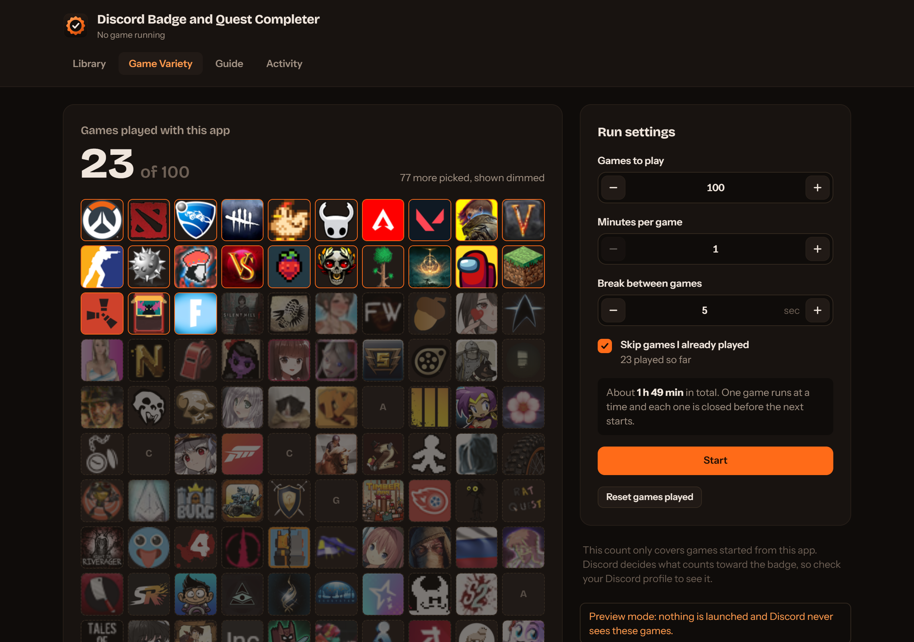
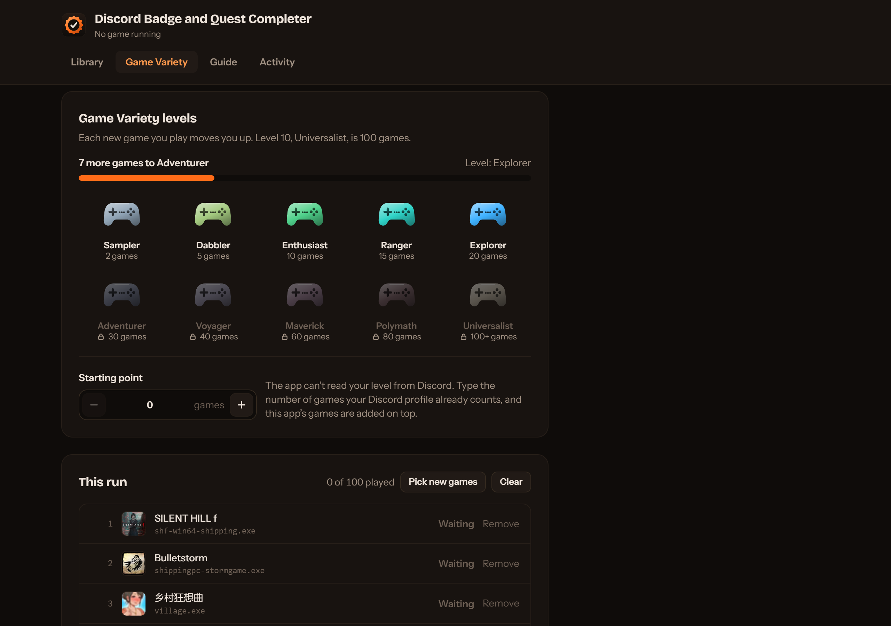
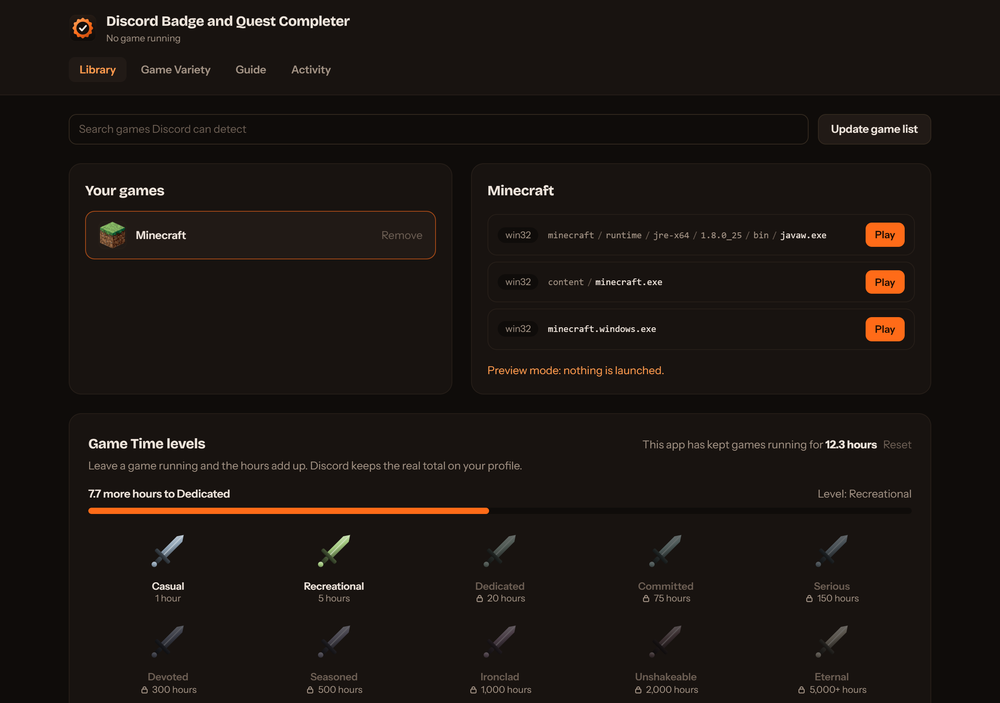
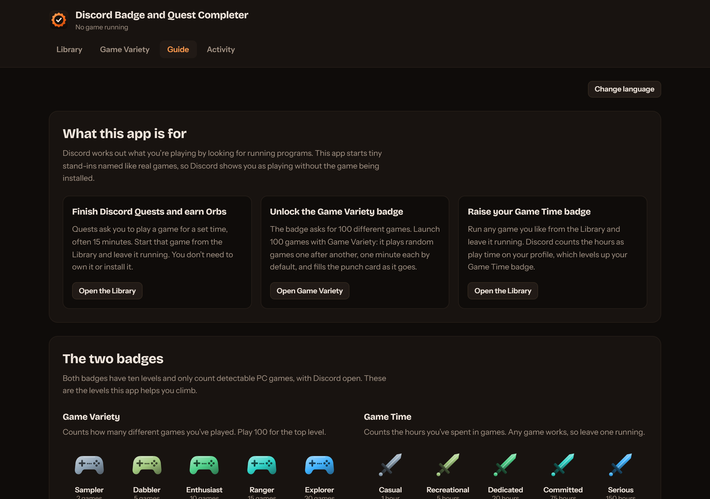
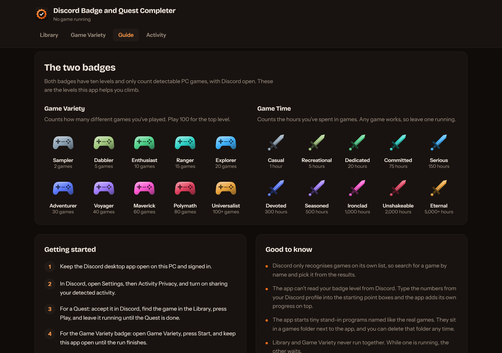

# Discord Badge and Quest Completer

A Windows desktop app that makes Discord show you as playing a game, without installing the game.

- **Finish Discord Quests and earn Orbs** without owning the game.
- **Climb the Game Variety badge.** The Game Variety page plays random Discord-detectable games one at a time (100 games, 1 minute each, 5 seconds apart by default) and fills a 100-cell punch card with each game's icon.
- **Raise your Game Time badge** by starting any game you like and leaving it running.

Both badges are shown with their ten levels, and there is a built-in guide in English and Sinhala.

> [!NOTE]
> Discord does not update badge progress straight away. New games and hours can take up to 24 to 48 hours to show on your profile. The app cannot read your badge level from Discord. The optional "Starting point" boxes let you type in the numbers from your profile.

## Download

Get the latest zip from the [Releases page](https://github.com/draxctrl/discord-badge-quest-completer/releases/latest), unzip it somewhere you can write files, and run `discord-quest-completer.exe`. Keep the `data` folder next to it.

The app is not code-signed, so Windows may say "unknown publisher". Choose More info, then Run anyway. The release page lists a SHA-256 checksum so you can check the download.

## Screenshots

The numbers in these screenshots are sample data, so you can see how progress looks.

**Game Variety**: the punch card fills with each game's icon. Picked games show dimmed until they are played.



**Badge levels and the run list**: your progress to the next level, and the games picked for this run.



**Library**: search any detectable game, start or stop it by hand, and see the Game Time levels.



**Guide**: what the app is for and how to start, in English and Sinhala.





## How it works

Discord works out what you are playing by looking for running programs. This app creates tiny stand-in programs named like real games (about 13 KB each) in a `games/` folder next to the app, and runs them. Each shows a small window with the game's icon. Discord sees the program and shows you as playing. Nothing is injected into Discord, and the app never asks for your Discord login or token.

The stand-ins only do this: stay open. You can delete the `games/` folder at any time.

The app talks to a few places: Discord's public list of detectable games (and a GitHub mirror of it), Discord's image server for game icons, and the Gameza banner in the header. Clicking the banner opens gameza.lk.

## Using it

1. Keep the Discord desktop app open and signed in on the same PC.
2. In Discord, open **Settings, then Activity Privacy**, and turn on sharing your detected activity.
3. **Library**: search for a game, add it, press Play. Stop it when you are done.
4. **Game Variety**: set how many games, minutes per game and break, then press Start. One game runs at a time, and each is closed before the next starts. If a game cannot be closed, the run stops instead of starting another.

The app and its `data/` folder must stay together. Keep the app somewhere you can write files (not `C:\Program Files`). Windows 11 includes WebView2; on older Windows you may need to [install it](https://developer.microsoft.com/en-us/microsoft-edge/webview2).

## Build from source

You need Node 20+, [pnpm](https://pnpm.io), Rust, and the [Tauri prerequisites](https://tauri.app/start/prerequisites/) for Windows (including the C++ build tools).

```bash
pnpm install
pnpm sync:runner        # builds the small stand-in program and copies it into src-tauri/resources
pnpm tauri dev          # run in development
pnpm tauri build        # build the app
```

Tests:

```bash
pnpm test               # TypeScript unit tests
cd src-tauri && cargo test
```

Project layout: `src/` is the Vue interface, `src-tauri/` is the Rust app, and `src-win/` is the stand-in program (C++ with no C runtime, so it stays small).

## Credits and license

This is an enhanced version of [Discord Quest Completer](https://github.com/markterence/discord-quest-completer) by Mark Terence Tiglao. If you find the original useful, consider supporting [the author](https://github.com/markterence).

Released under the [MIT License](LICENSE), which keeps the original copyright notice.

## Disclaimer

This tool is intended for educational purposes and personal use. Faking game activity may go against Discord's Terms of Service. Please respect Discord's terms of service, partners, game publishers and advertisers' rights when using this application.

The creators and maintainers of this project are not liable for any damages, account suspensions, or other consequences that may arise from using this software. Use at your own risk.

Discord is a registered trademark of Discord Inc. It is referenced on this open-source project for descriptive and definition purposes only and does not imply any affiliation, sponsorship, or endorsement by Discord Inc in any way.
